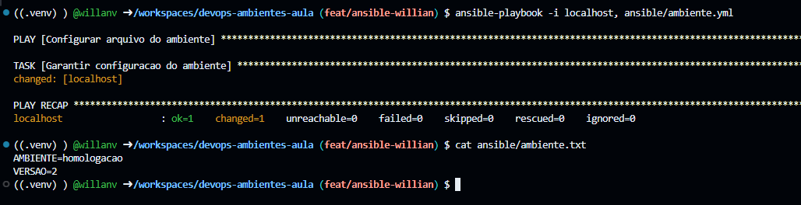
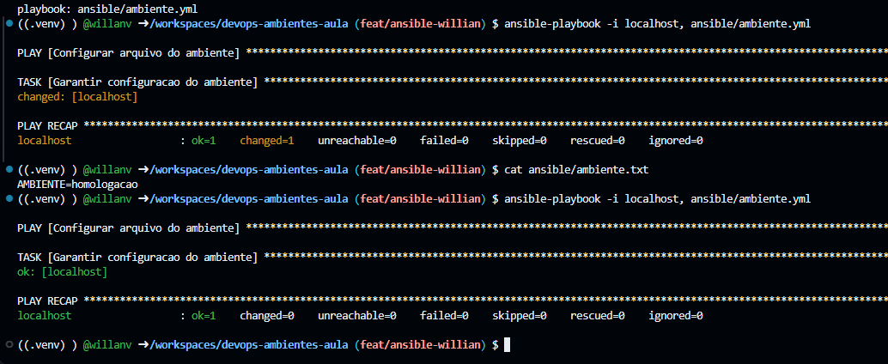
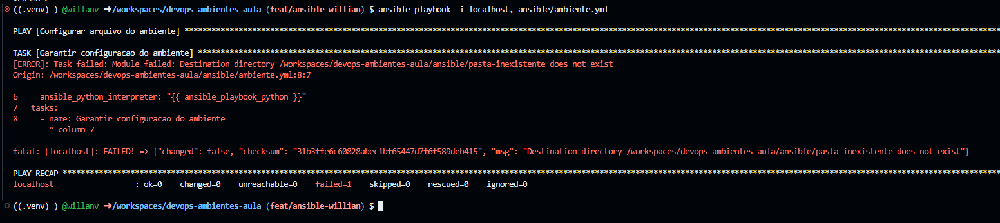
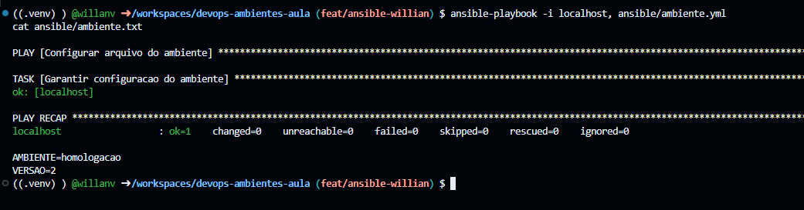

# Evidências dos Laboratórios — DevOps Unidade 3

**Universidade:** Universidade Veiga de Almeida (UVA)

**Professor:** Prof. Dr. Felipe Cordeiro

**Integrantes:**
- Pedro Henrique Novaes — 1250216570
- Willian Carvalho Velasco — 1250123808

## 1. Mudança aplicada

O playbook Ansible foi atualizado para incluir `VERSAO=2` no arquivo `ambiente.txt`. A execução apresentou `changed=1` e `failed=0`, confirmando a alteração.

## 2. Repetição sem mudança

O playbook foi executado novamente sem alterações na configuração. O resultado `changed=0` demonstra que o Ansible preservou o estado correto do arquivo, caracterizando a idempotência.

## 3. Falha controlada

O caminho de destino foi alterado para uma pasta inexistente. A execução apresentou `failed=1`, pois o Ansible não encontrou o diretório necessário para gravar o arquivo.

## 4. Correção e recuperação

O caminho de destino foi restaurado para `{{ playbook_dir }}/ambiente.txt`. O playbook voltou a executar sem erros (`failed=0`), e o conteúdo do arquivo foi confirmado.
