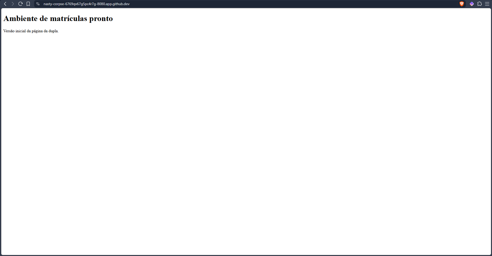
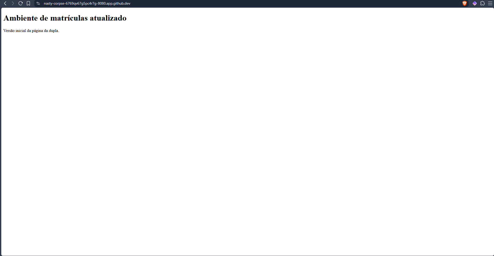
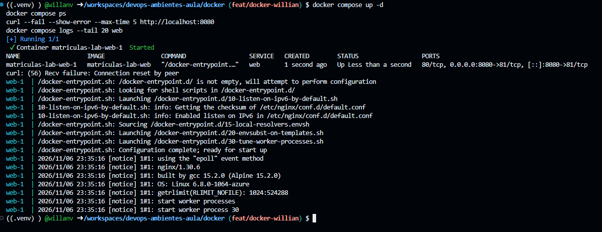
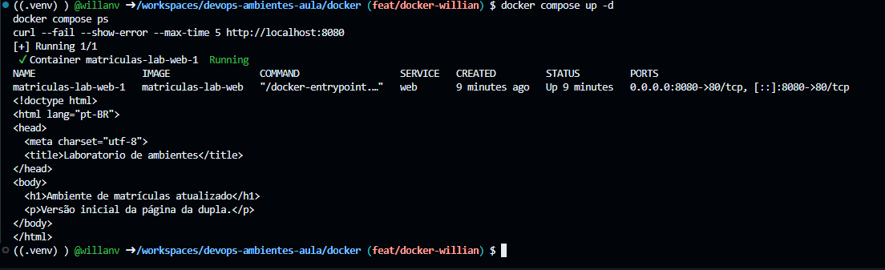

# Evidências do Docker — DevOps Unidade 3

**Universidade:** Universidade Veiga de Almeida (UVA)

**Professor:** Prof. Dr. Felipe Cordeiro

**Integrantes:**
- Pedro Henrique Novaes — 1250216570
- Willian Carvalho Velasco — 1250123808

## 1. Funcionamento inicial



O Nginx foi executado utilizando Docker Compose, disponibilizando a página do sistema de matrículas pela porta 8080. O teste com `curl` confirmou que a aplicação estava respondendo corretamente.

## 2. Atualização da página



Alteramos o conteúdo do arquivo `docker/index.html` e reconstruímos a imagem com `docker compose up --build -d`. A nova consulta confirmou que a página passou a apresentar a mensagem atualizada.

## 3. Falha controlada



Para provocar uma falha, alteramos o mapeamento de portas no arquivo `docker/compose.yaml`.

**Configuração incorreta:**

```yaml
ports:
  - "8080:81"
```

O Nginx estava configurado para atender na porta 80, mas o Docker encaminhava as solicitações para a porta 81 do contêiner.

Ao executar o teste HTTP, recebemos o erro `curl: (56) Recv failure: Connection reset by peer`, indicando que a aplicação não estava respondendo corretamente.

## 4. Correção e recuperação



Restauramos o mapeamento correto no `compose.yaml`:

```yaml
ports:
  - "8080:80"
```

Depois, reconstruímos o serviço e repetimos a consulta HTTP. O `curl` retornou o HTML atualizado da página, confirmando que o acesso à aplicação foi recuperado.

## 5. Conclusão

O exercício demonstrou que uma configuração incorreta de portas pode impedir o acesso à aplicação, mesmo com o contêiner iniciado. A correção do mapeamento e a repetição do teste HTTP permitiram confirmar a recuperação do serviço.
