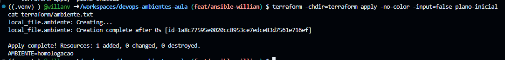
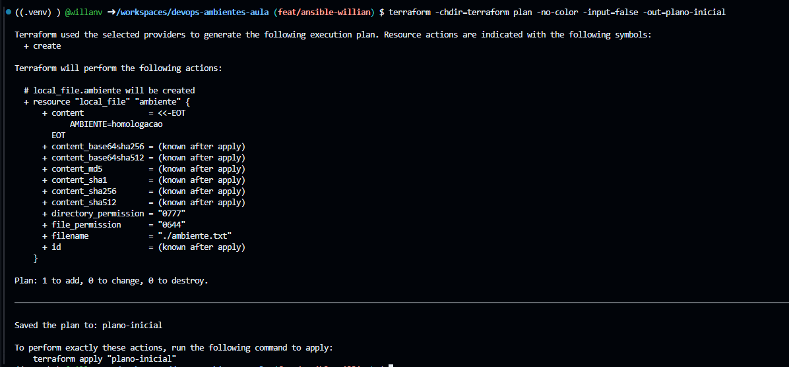
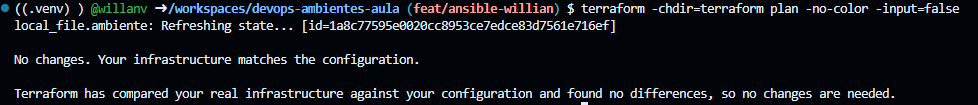
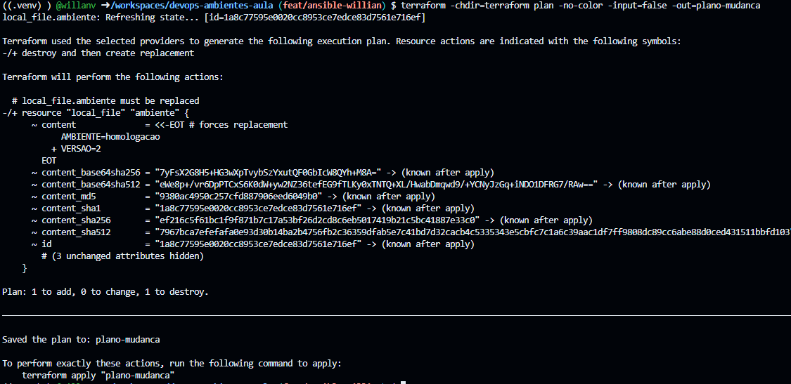
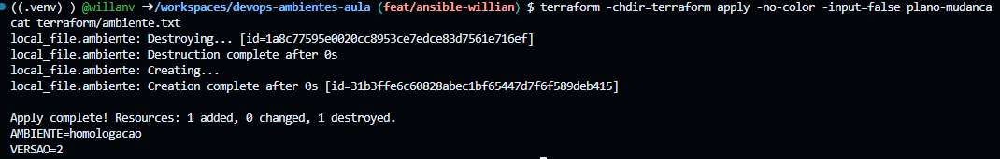
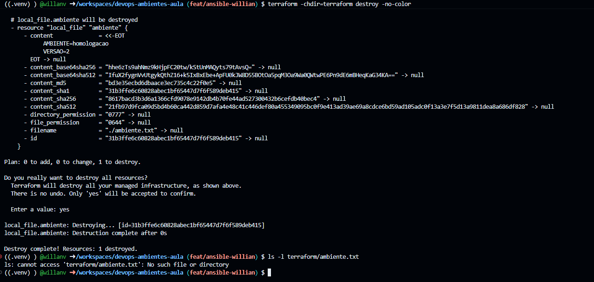

# Evidências do Terraform — DevOps Unidade 3

**Universidade:** Universidade Veiga de Almeida (UVA)

**Professor:** Prof. Dr. Felipe Cordeiro

**Integrantes:**
- Pedro Henrique Novaes — 1250216570
- Willian Carvalho Velasco — 1250123808

## 1. Planejamento inicial

Após inicializar e validar o Terraform, executamos o comando `terraform plan` para verificar quais recursos seriam criados.

O resultado indicou `1 to add, 0 to change, 0 to destroy`, mostrando que o arquivo `ambiente.txt` seria criado.

## 2. Aplicação inicial

Executamos o comando `terraform apply` para criar o recurso `local_file.ambiente`.

A execução foi concluída com sucesso e o arquivo apresentou o conteúdo `AMBIENTE=homologacao`.

## 3. Verificação sem alterações

Executamos novamente o comando `terraform plan`, sem modificar a configuração.

O Terraform informou `No changes`, confirmando que o recurso já estava de acordo com o estado definido no código.

## 4. Planejamento da mudança

Alteramos o arquivo `terraform/main.tf` para acrescentar `VERSAO=2` ao conteúdo do recurso.

O novo planejamento indicou `1 to add, 0 to change, 1 to destroy`, mostrando que o Terraform precisaria substituir o arquivo para aplicar a mudança.

## 5. Aplicação da atualização

Aplicamos a mudança planejada utilizando o comando `terraform apply`.

A execução foi concluída com sucesso, e a leitura do arquivo confirmou o conteúdo atualizado:

- `AMBIENTE=homologacao`
- `VERSAO=2`

## 6. Encerramento do recurso

Ao final do laboratório, executamos `terraform destroy` para remover o recurso criado.

O resultado apresentou `Destroy complete! Resources: 1 destroyed`.

Em seguida, verificamos que o arquivo `terraform/ambiente.txt` não existia mais, confirmando a remoção.

## 7. Conclusão

O laboratório permitiu compreender a diferença entre planejar, aplicar e verificar uma alteração no Terraform.

Também observamos que, quando a configuração já corresponde ao estado desejado, o Terraform não identifica novas mudanças. Por fim, realizamos o encerramento do recurso criado durante o exercício.